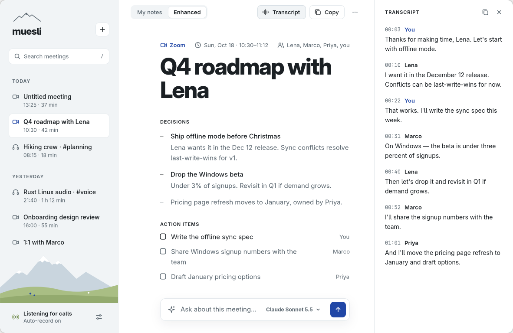
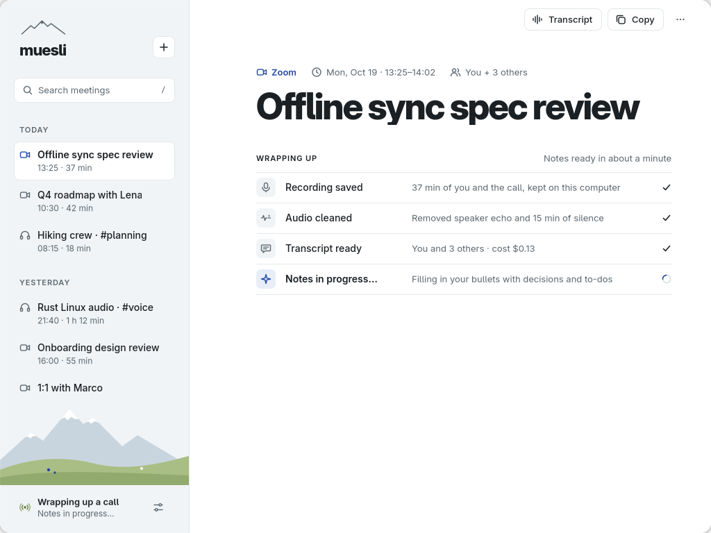
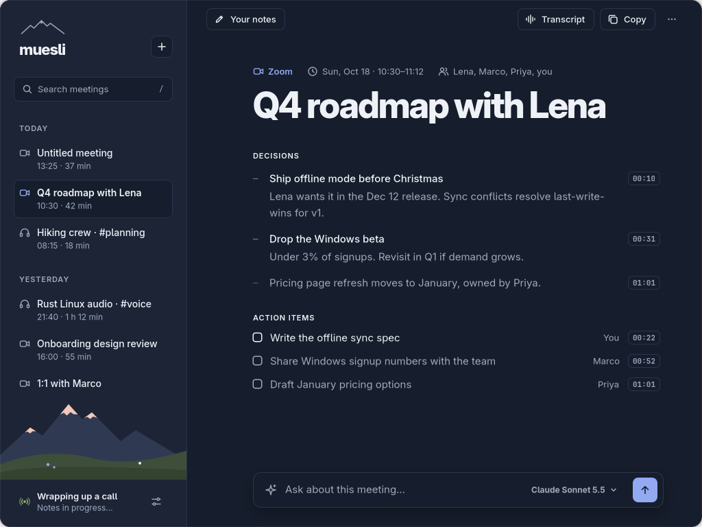
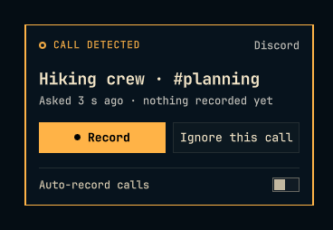
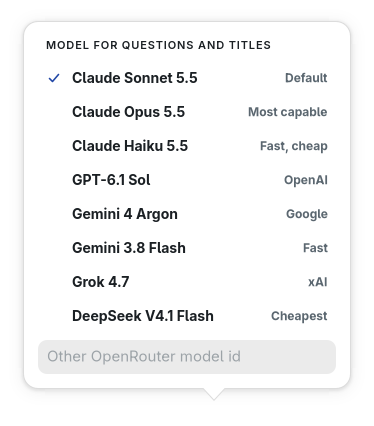

<p align="center">
  
</p>

<h1 align="center">muesli</h1>

<p align="center">
  <b>Your meetings, written up before you've closed the call.</b><br>
  Local AI meeting notes for Linux. No bot in the call, no subscription, no Electron.
</p>

<p align="center">
  
  
  
  
  
</p>

<p align="center">
  
</p>

Join a Zoom or Discord call and muesli quietly starts taking notes. Jot a few bullets if you
like, or don't. Hang up, and a minute later you have a titled meeting with decisions, action
items with owners, and a transcript that knows who said what.

It runs on your machine, listens the way you already do (your mic and your speakers), and
never joins the call as a participant. You bring an OpenRouter key and pay a few cents per
meeting, not a monthly fee.

## How it feels

1. **Join a call.** muesli spots it within seconds and starts recording, or asks first if you
   prefer. A timer appears in your bar.
2. **Take notes, or don't.** Type rough bullets in the app while you talk. They stay yours,
   word for word.
3. **Hang up.** Echo is removed, silence trimmed, speech transcribed, and your bullets are
   filled in with what was decided and who's doing what. The meeting is titled for you, too.
4. **Check anything.** Every point carries a timestamp. Click it to jump to that moment in the
   transcript and hear it.

## Why muesli

| | muesli | Granola | Meeting bots (Otter, Fireflies, …) |
|---|---|---|---|
| Runs on Linux | **Yes, natively** | No (macOS, Windows) | Browser only |
| Joins your call as a participant | **No** | No | Yes |
| Works with Discord | **Yes** | No | Varies |
| Open source | **Yes, MIT** | No | No |
| Choose your own models | **Any model on OpenRouter** | No | No |
| Pricing | **Pay per use, ~$0.10–0.30 per hour** | Subscription | Subscription |
| Where your notes live | **On your machine** | Their cloud | Their cloud |

## Features

- **Hands-free call detection.** Zoom and Discord, as native apps or in the browser.
  PipeWire tells muesli the moment an app opens your mic, so there is no polling and idle
  costs nothing.
- **Auto-record or ask first.** Either recording starts and you can stop or discard it, or
  muesli asks and waits. Override it per app.
- **Built for speakers, not just headphones.** Your mic and the call are recorded as separate
  channels, and WebRTC echo cancellation strips the call out of your mic afterwards
  (about −26 dB on a real call), so nobody is transcribed twice.
- **Your notes, filled in.** Your own bullets are kept exactly as written; the AI adds context,
  decisions and to-dos underneath, visibly marked as its additions. One click on **Your notes**
  takes you back to what you typed.
- **Every point shows its source.** Each note and to-do links to the transcript lines it came
  from. Click the timestamp to see them highlighted and hear the moment. Sources are checked
  against the real transcript, so the AI can't cite lines that don't exist.
- **Play it back.** Listen to any meeting with the echo already removed, scrub through it, or
  click any line of the transcript to play from there. The transcript follows along.
- **Named for you.** When the call ends, muesli titles it from what was actually said. No
  naming step: click the title any time to change it.
- **A transcript that knows who's talking.** "You" comes from your mic; other voices are
  separated by the transcription model and named when the conversation makes it clear.
  Rename or merge speakers with a click, and copy the whole transcript as text.
- **Ask your meeting.** "What did we decide about Windows?" Answers come from that meeting's
  notes and transcript, using the model you pick: Claude, GPT, Gemini, Grok, DeepSeek, or
  anything else on OpenRouter.
- **Lives in your Omarchy bar.** Recording timer, Record / Ignore, Stop / Next meeting / Discard,
  styled by your current theme.
- **Featherweight.** The background service idles at about 11 MB of memory and 0% CPU. The app
  is native GTK4 / libadwaita. No Electron, no webview, no muesli account.
- **Hooks for everything else.** Drop a script in `~/.config/muesli/hooks/meeting-ready.d/`
  and it runs when notes are done, with the meeting as JSON: copy notes into your wiki or
  vault, post to chat, file to-dos in your tracker. See [docs/hooks.md](docs/hooks.md).
- **Crash-proof recording.** Audio is written in small Opus segments that survive a crash or a
  dead battery; processing picks up where it left off.

## Screenshots

| Wrapping up after the call (already named) | Dark mode |
|---|---|
|  |  |

The Omarchy bar widget's panel when a call is detected, in your current Omarchy theme:



<p align="center"></p>

## How it works

```
PipeWire events ──► detector ──► record / ask ──► recorder: your mic + call audio → Ogg Opus on disk
                                                        │ hang up
                                                        ▼
            clean: echo cancellation (mic vs. speakers) → trim silence → speech-only chunks
                                                        ▼
   OpenRouter speech-to-text (speaker labels) → merged transcript → title suggestions → notes → SQLite
```

- **Detection:** a live microphone stream from Zoom or Discord, or from a browser while a
  Zoom or Discord window is open. A call counts as started after about 5 s (mic tests don't
  trigger it) and as ended about 20 s after the mic closes.
- **Two channels:** your microphone is "You"; the monitor of your default output is everyone
  else. That separates you from the call without any guesswork.
- **After the call:** echo removal and silence trimming run locally. Speech-only audio is sent
  to OpenRouter for transcription (ElevenLabs Scribe v2 by default, with fallbacks), then a
  chat model (Claude Sonnet 5.5 by default) writes the title suggestions and notes.
- **Crash-safe:** audio is written in 5-minute Opus segments that stay readable even if the
  machine dies mid-call; processing resumes on restart.

## Requirements

- Linux with **PipeWire** (default on most current distros).
- **GTK 4.22+ and libadwaita 1.9+** for the notes app (current Arch / Omarchy).
- An **OpenRouter API key** ([openrouter.ai](https://openrouter.ai)).
- A notification daemon that supports action buttons (Omarchy, GNOME, KDE, mako and dunst do).
- **Hyprland** for detecting calls in the browser (it reads window titles). Native Zoom and
  Discord apps are detected on any desktop.
- Rust (stable) to build. Echo cancellation links the system `webrtc-audio-processing` ≥ 2.1
  if present, otherwise builds it from source (needs `meson` and `ninja`).

Developed and tested on [Omarchy](https://omarchy.org) (Arch + Hyprland). Other distros and
desktops should mostly work, minus browser-call detection outside Hyprland.

## Get started

On Omarchy or Arch:

```bash
git clone https://github.com/sepehr500/muesli && cd muesli
./install.sh          # builds release binaries into ~/.local/bin and enables the user service
muesli-cli set-key    # paste your OpenRouter key (hidden input)
```

Optional, on Arch: `sudo pacman -S webrtc-audio-processing inter-font` for faster builds and
the intended typeface. An AUR-style `packaging/PKGBUILD` is included for `makepkg`.

**Omarchy bar widget:** `install.sh` links the plugin. Add it to `bar.layout.right` in
`~/.config/omarchy/shell.json`:

```json
{ "id": "ssobhani.muesli" }
```

## Use

Join a call. A notification and the bar widget show that muesli is recording (or asking,
if auto-record is off). Hang up, and about a minute later your notes are ready: open them
from the notification, the bar, or the app launcher (`muesli`).

**Back-to-back meetings:** when one meeting runs straight into the next on the same call,
press **Next meeting** (in the notification, the bar panel, or the app's **+** menu). muesli
closes the first meeting and keeps recording into a new one without dropping a second of
audio; each gets its own notes and title.

```text
muesli-cli status | watch [--json]            what's happening now
muesli-cli toggle | start | stop | discard    control recording
muesli-cli next                               end this meeting, keep recording the next
muesli-cli record | ignore                    answer an "ask first" prompt
muesli-cli auto-record on|off|toggle
muesli-cli list | show <id> | open [<id>]
muesli-cli rename <id> "Title"
muesli-cli rename-speaker <id> "Speaker 2" "Lena"
muesli-cli reprocess <id> | enhance <id> | delete <id>
muesli-cli import --manifest /abs/import.json --json   add an external recording (docs/import.md)
muesli-cli hooks list | run | log | retry     hook scripts (docs/hooks.md)
muesli-cli detect                             debug: what the call detector sees
```

Hyprland keybind example: `bind = SUPER SHIFT, M, exec, muesli-cli toggle`

## Privacy and data

- **What leaves your machine:** speech-only audio goes to OpenRouter for transcription;
  transcripts and your notes go to OpenRouter's chat models for titles, notes and questions.
  Nothing else is sent anywhere.
- **Zero data retention:** set `zdr = true` to route only to OpenRouter providers that don't
  store requests.
- **On disk:** recordings, transcripts and notes stay in `~/.local/share/muesli/`, and the API
  key in `~/.config/muesli/openrouter.key`. Both folders are private to your user (0700), and
  the key file is 0600. Audio is kept until you delete the meeting, unless you set
  `audio_retention_days`.
- **Consent:** recording laws differ by place, and some require everyone's consent. Let
  people know you're taking notes.

## Cost

You pay OpenRouter directly, per use. With the defaults, transcription is about
$0.002 per minute of speech per channel (silence is never sent), and notes with Claude Sonnet 5.5
cost a few cents per meeting. A typical one-hour call comes to roughly $0.10–0.30. Each
meeting shows what it cost.

## Configuration

`~/.config/muesli/config.toml` (every field optional; the Settings dialog edits the common ones):

```toml
[openrouter]
stt_models    = ["elevenlabs/scribe-v2", "assemblyai/universal-3-6-pro", "fish-audio/transcribe-1-pro"]
chat_model    = "anthropic/claude-sonnet-5.5"  # titles and questions
enhance_model = "anthropic/claude-sonnet-5.5"  # notes
zdr           = false                          # true: zero-data-retention providers only

[recording]
auto_record          = true    # false: ask before recording
start_debounce_s     = 5
end_grace_s          = 20
audio_retention_days = 0       # 0 = keep audio until the meeting is deleted
echo_cancellation    = true

[apps.discord]
auto_record = false            # per-app override
```

Custom note sections: put a template in `~/.config/muesli/templates/default.md`.

## Development

| Path | What |
|---|---|
| `crates/core` | Domain model, detection rules, recording state machine, transcript logic, prompts, SQLite store, IPC protocol, OpenRouter client. Pure and unit-tested. |
| `crates/audio` | PipeWire capture, Ogg Opus, voice activity detection, chunking, echo cancellation |
| `crates/daemon` | `muesli-daemon`: detector, session loop, post-call pipeline, socket server, notifications |
| `crates/cli` | `muesli-cli` |
| `crates/ui` | `muesli`: the GTK4 / libadwaita notes app |
| `omarchy-plugin/` | Omarchy shell bar widget and panel (QML) |

```bash
cargo test --workspace
MUESLI_HOME=/tmp/muesli-dev ./target/debug/muesli-daemon      # isolated config, data and socket
MUESLI_HOME=/tmp/muesli-dev cargo run -p muesli-ui --example seed   # demo meetings for the app
```

`MUESLI_UI_DEBUG=1 muesli` logs UI events to stderr.

## License

[MIT](LICENSE)
